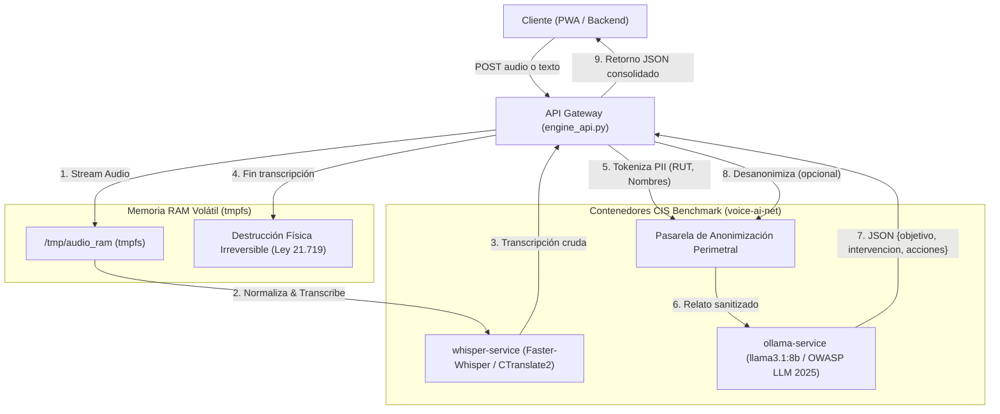

# Arquitectura Técnica - Voice_AI_Engine

## 1. Visión General
`Voice_AI_Engine` es un subsistema local On-Premise diseñado para la **Centro Terapéutico Residencial (Institución de Salud Especializada)**. Su propósito es capturar atenciones clínicas por audio o texto, procesarlas de forma completamente privada y devolver una síntesis clínica homologada en 3 campos normativos:
- **`objetivo`**: Motivo o propósito central de la intervención.
- **`intervencion`**: Situaciones abordadas, factores de riesgo y técnicas terapéuticas aplicadas.
- **`acciones_a_seguir`**: Tareas intersesión, acuerdos conductuales y próxima citación.

---

## 2. Diagrama de Flujo del Pipeline (Arquitectura de Seguridad)



---

## 3. Matriz de Cumplimiento Normativo y Hardening

| Componente | Norma / Estándar | Mecanismo de Control |
| :--- | :--- | :--- |
| **Audio de Voz** | Ley N° 21.719 (Datos Biométricos) | Montaje exclusivo en `tmpfs` en RAM (`/tmp/audio_ram`). Destrucción física mediante sobrescritura con ceros (`0x00`) y bytes aleatorios (`urandom`) en bloque `finally`. Cero persistencia en disco. |
| **Datos de Salud** | Ley N° 20.584 y Ley N° 19.628 | Pasarela perimetral de seudonimización antes de invocar cualquier modelo LLM. |
| **Contenedores Docker** | CIS Docker Benchmark v1.6.0 | Ejecución no-root (`10001:10001`), `read_only: true`, `cap_drop: ALL`, `no-new-privileges: true`. |
| **Inferencia LLM** | OWASP Top 10 for LLM Applications 2025 | Delimitación estricta de contexto (`<<<NARRATIVA_CLINICA_INICIO>>>`), prompt pasivo anti-inyección y esquema JSON cerrado. |
| **APIs Expuestas** | OWASP Top 10 API Security | Validación de esquemas con Pydantic v2, límites de carga (50 MB), sanitización de extensiones. |

---

## 4. Guía de Ejecución Rápida

### A. Despliegue con Docker Compose
```bash
# 1. Copiar variables de entorno
cp .env.example .env

# 2. Construir imágenes bastionadas
docker compose build

# 3. Iniciar servicios en segundo plano
docker compose up -d

# 4. Validar salud de los servicios
docker compose ps
curl http://127.0.0.1:8000/health
curl http://127.0.0.1:11434/api/tags
```

### B. Ejecución del Pipeline Local en Python
```bash
# Ejecutar suite de pruebas
python test_engine.py

# Iniciar servidor de API Gateway
uvicorn core.engine_api:app --host 0.0.0.0 --port 8080 --reload
```
